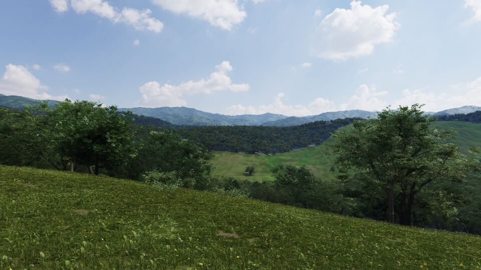
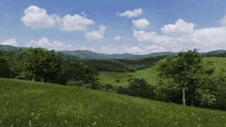
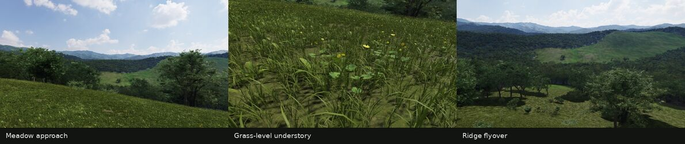

# CYBR Forest · V9

Explore a live, raster-rendered meadow and woodland: walk through the grass, change the sun angle, or fly above the forest. This repository includes the runnable WebGPU/WebGL 2 scene, its runtime assets, offline conversion tools, and recorded verification.





*The GIF is derived from the shipped two-second [1080p motion sample](dist/evidence/meadow-motion.mp4). The still above and the camera study below are frames rendered from the V9 scene.*



## Quick start

Clone or download this repository, then run from its root:

```sh
python -m http.server 8000 --directory dist
```

Open [http://localhost:8000](http://localhost:8000/) in a graphics-accelerated browser. No build, API keys, or runtime package installs are needed. Serve over localhost or HTTPS rather than opening the HTML as a local file.

| Input | Action |
| --- | --- |
| Click or drag | Look around |
| `W` `A` `S` `D` | Move |
| `Q` / `E` | Change elevation |
| `Shift` | Move faster |
| `H` | Toggle the interface |

The UI includes touch controls, meadow/forest/aerial camera presets, a camera tour, sun and sky controls, diagnostics, and PNG capture. PNG capture waits for a drawn frame, with a twelve-second timeout; if automatic download is blocked, use the ready link.

The app tries a live WebGPU renderer, then WebGL 2 when needed. If neither path starts, it opens recorded views. You can open [the recorded views directly](http://localhost:8000/?view=stills) without needing live GPU rendering.

## Repository map

| Path | What lives there |
| --- | --- |
| [`dist/`](dist/) | Browser entry point, scene, renderers, shaders, assets and the recorded-view fallback |
| [`dist/assets/`](dist/assets/) | Packed meshes, material maps, impostors, terrain, HDR environment and asset provenance |
| [`dist/evidence/`](dist/evidence/) | Scene captures, motion samples, visual comparisons and measurements |
| [`tools/qa/`](tools/qa/) | Offline checks for renderer paths, vegetation, temporal history, coverage, shadows and fallback |
| [`tools/reference/`](tools/reference/) | Offline Cycles reference renders and comparison workflow |
| [`tools/meadow/`](tools/meadow/) | Ground-cover asset acquisition and baking |

## Landscape and tree detail

The eye-level meadow narrows diagonally between irregular edge groves and wooded hills. Inner wooded spurs flank the drainage. Between 1.56 and 2.42 km from the meadow, their heights blend into a 32.5-metre grid sampled from Mapzen elevation tiles in the Smoky Mountains. Beyond that transition the surveyed ridgelines determine the mountain silhouette. The vertical scale is 0.737 and the elevation datum is shifted to fit this scene. Tile addresses, checksums and attribution are in `dist/assets/outer-ridges.json`. Rebuild the field with `python tools/terrain/build-ridges.py`. The photo view uses a 50 degree vertical field of view. The explicit forest domain is 4 × 4 km with 90,000 instances by default and 30,000 / 250,000 settings. Terrain and aggregate forest extend farther. On the outer range, a 256 m patch assembled from the two source leaf-density fields supplies filtered, sub-grid crown normals and a 16-direction sky aperture. Rebuild the 512² field and its ten mip levels with `python tools/terrain/bake-stand-relief.py`. Eight precomputed horizon sectors per outer-canopy vertex describe the surrounding relief and modulate sky and sunlight as the sun moves. A lower understory between explicit trees breaks up exposed forest floor on the wooded slopes.

An additional 48 placements use four deterministic growth forms along the meadow edge and forest walk. The forked broadleaf, coppice stool, thorn scrub and slender sapling have connected branch axes and share the photographed leaf material. Their close and medium representations retain the same leaf shoots. `node tools/qa/hedgerow.mjs` checks the geometry.

Two distinct Poly Haven authored tree assets have photographic bark and leaf materials. Tree Small 02 is scaled to approximately 16 m. Jacaranda retains its native 19.47 m height and broad mature crown. The common name `oak` in the impostor implementation is a renderer identifier, not a verified botanical identification of Tree Small 02.

| Representation | Tree Small 02 | Jacaranda |
| --- | ---: | ---: |
| Detailed mesh triangles | 160,623 | 287,558 |
| Medium mesh triangles | 31,301 | 34,764 |
| Full source used for impostor baking | 2,062,487 | 3,863,832 |
| Runtime distant tree | 2 triangles | 2 triangles |

Nearby trees retain every source leaf component at its authored position and scale, including all 30,250 shoots of Tree Small 02 and 116,084 Jacaranda fronds. Each shoot fits a small curved or bilinear surface to the original vertices and normals. Its cutout combines the original triangle footprint with photographed foliage alpha. Medium trees use deterministic component sampling and area compensation. Seven directional transmissions through the source leaf-density field control direct sunlight. A separate 64-direction cosine-weighted hemisphere integral estimates the sky opening at each vertex and at each reconstructed impostor surface. Both representations apply the same per-tree pigment variation and an approximate single interaction with the surrounding foliage to the blocked part of the skylight.

Distant trees use eight azimuth and two elevation captures baked from the full source meshes. The current camera ray is reprojected through up to four neighboring captures using their stored source positions. Their angular weights vary continuously. The reconstructed surface position writes depth as well as supplying lighting and haze. Zero-alpha atlas texels carry extended valid data so filtering cannot pull surfaces toward an empty texel’s origin. Three atlases store linear albedo/coverage, source-model normals/sky visibility, and actual source-model surface position/leaf fraction. Source normals are oriented toward each baked capture before filtering. Directional sunlight extinction uses the actual baked surface point and a 96³ per-model leaf-area-density volume. A 24-step ray integrates density toward the current model-space sun with Beer–Lambert extinction. Density comes from alpha-weighted full source leaf geometry, preserving clumps and gaps. Source leaf-area quantization error is below 0.7%; branch wood and individual leaf-scale transport are approximations. Sky visibility remains separate. Near photographic geometry and far trees share the same source color without a warm tint applied only at distance. Runtime lighting relights those values. Coverage-weighted mipmaps preserve thin foliage and normal variance. The atlas PNG decoder preserves exact bytes, avoiding browser color conversion and premultiplication of data channels. These are geometry-derived impostors, not a background forest photograph.

## Ground cover, lighting and renderer

The renderer streams 180,000 near meadow cells and 65,536 farther cells. Four GPU buckets select the two grass communities, flowering colonies and seeding tussocks. The near bank also includes deterministic bare soil gaps, lodged grass and sparse recruits. Flowering stems rise above the neighboring grass in moist pockets. Farther flower heads retain their physical size as the spacing between grass patches increases. Overlapping multi-metre stand fields influence species, height and pigment. The near bank covers 70 m with a 40–70 m transition into lower-detail geometry. The farther representation extends to 170 m, refreshed at 20 m movement with a nearest 16 m anchor. Near cells use 0.4 m spacing with restrained cell jitter so adjacent 0.6 m patches overlap. Overlapping streamed cells retain identical transforms.

The two grass patches use sixteen volumetric depth slices baked from dense clusters of 64 original photographic plant specimens. Source leaf-area index is approximately 2.3–2.5 before boundary clipping. Six X slices, six Z slices, and four horizontal slices represent each cluster with 32 runtime triangles. Albedo/alpha and tangent normals are captured from actual source geometry. These representations keep the dense source clusters' appearance without drawing their roughly 110,000–120,000 triangles in every cell. Inside 12 metres, each patch uses modeled basal tillers and arching blades in paired ranks. Blade pigments come from the two photographic grass captures. Older blades fold into local swaths. Independent herb communities include plantain rosettes, trifoliate leaves, celandine and dandelion. The sliced basal representation fades in over 7–11 metres and the explicit basal blades fade out over 8–12 metres. Both the turf and close herb geometry cast shadows. Slice depth and close intersections remain approximations.

Plants sit on the exact rendered terrain triangles. Their basal planes follow the triangle gradients, so low leaves do not disappear inside a sloping hillside. Plant scales use a separate deterministic hash from species selection. Dense grass receives approximate height-dependent Beer–Lambert skylight and sun extinction using source LAI ≈2.3 and extinction coefficient 0.5. Basal foliage self-shades while the upper blades and flowers extend above the dense layer. The template maximum heights range from 0.38 m for basal grass to 0.67 m for flowering colonies before each instance’s scale. Wind remains pinned at the root. Grass lighting samples above the coarse ground occupancy slab to avoid treating soil as overhead canopy occlusion.

The opposite field includes intersecting swales, knolls, thinner pasture on exposed shoulders and woody stream margins. A six-direction subpixel grass model blends toward the explicit grass and integrates projected leaf area, local stand orientation, substrate and estimated optical depth. Terrain uses three stochastically rotated source samples, with their tangent normals rotated back into the terrain frame. Filtered moisture and tuft variation operate at metric scales without a repeating macro texture. Nine 512 × 512 material-array layers contain grass ground, forest floor, bark, the two tree leaf atlases, and four meadow atlases. Albedo is sRGB, normals are linear, and ten mip levels are packed largest first. Color and normal filtering use alpha coverage. The volumetric grass atlases preserve cutout coverage per slice as they minify.

Direct sunlight is calibrated by integrating the HDR solar disk. The shared surface shader uses rough GGX specular reflection, reflected photographic pigment and bounded transmission through thin leaves. An integrated 32 × 16 reflectance table partitions diffuse and sky reflection consistently at grazing angles. It occupies a 512-byte filtered texture. Diffuse skylight comes from nine spherical harmonic coefficients integrated from the actual HDR sky, excluding the brightest direct-sun pixels to avoid counting them twice. Lambert convolution supplies diffuse irradiance. Coefficients rotate with the sky's vertical-axis sun alignment. The lower hemisphere uses an approximate ground-reflection term, documented in `assets/sky-irradiance.json`. Modeled tree lighting includes an estimate of sunlit ground and canopy bounce. Foliage normal mips encode angular variance to broaden the specular response at distance.

WebGPU compacts visible instances. A second, GPU-sized two-dimensional dispatch tests 64 spatial meshlet bounds per workgroup for each near tree. A stable Morton radix sort constructs the 64-triangle meshlets at startup. A 64³ occupancy and material field receives approximate one-bounce radiance with seven mip levels. Injection samples the common solar spectrum, cloud shadow and sky harmonics, distinguishes inclined ground from leaf volume and excludes buried voxels. Screen-space occlusion and color bounce supplement this field. A cached 4096² sun shadow map covers 720 m. Nearby leaves cast cutout shadows, and more distant trees use cheaper crown casters. A second 2048² sun map covers 32 metres around the camera and resolves mutual shadows between close blades and broad leaves. Its casters use the same shape and wind deformation as the visible meshes, including plants behind the camera. A separate 1024² stand-height map covers the full tree population, tracing the sun against neighboring crowns to shadow distant grazing fields and sheltered trees.

The sunlight energy is integrated from the actual HDR solar disk, in the same irradiance-over-pi units as diffuse sky lighting. A dielectric GGX model with height-correlated Smith visibility replaces the fixed Phong lobe. Reflected leaf albedo is retained, and transmission uses a channelwise portion of the remaining energy budget. A 512-byte, bilinearly filtered directional-reflectance texture gives the corresponding sky reflection and diffuse energy complement, including grazing views. Rough sky reflection currently uses the diffuse SH field along the mirror direction. It reproduces low-frequency sky energy while detailed environment reflections remain approximate. Calibration, source links and reproduction commands are in `dist/assets/illumination.json`.

The default sky is the CC0 Kloofendal 48d Partly Cloudy Pure Sky HDR environment by Greg Zaal and Jarod Guest. Vertical-axis rotation preserves its horizon. The opening front-lit meadow uses 38° elevation and 103° azimuth. Crosslight (48° / 345°) retains the matched view used for the previous-release comparison, and Backlight (38° / 283°) reverses the front-lit sun. A 2048×1024 packed floating-point panorama supplies the absolute RGB radiance. An 8192×2048 upper-hemisphere gain texture recovers luminance detail from the original 8K exposure. Its 14 filtered levels reduce shimmer during camera motion. The dome uses the largest level the GPU can sample. Its displayed radiance retains the original 1.25 exposure adjustment, roughly 0.32 EV above the HDR energy used for diffuse lighting. Run `python tools/build-sky-detail.py <official-8k-source.hdr>` to regenerate the gain texture from the source recorded in `dist/assets/sky-source.json`. Procedural clouds use a periodic 3D density ray march on WebGPU and a 2D approximation in compatibility mode. A cloud layer projects estimated sun transmittance from the photographed upper hemisphere onto the landscape. Camera motion leaves that projection anchored in the world. The default green aerosol extinction at the valley datum is 0.000108 per metre. Distance haze varies with wavelength, altitude and the length of the view ray within a clearer pocket around the pasture. Its directional airlight follows a five-term fit to the least clouded parts of the photographed 3–8 degree horizon band. Run `python tools/lighting/fit-horizon.py` to reproduce the coefficients. Terrain, trees, grass and their shadows are rendered geometry or relit geometry-derived impostors.

WebGPU rasterizes four coverage samples per pixel. Foliage groups use independent sample phases so overlapping leaves can fill a pixel. The color and normal buffers resolve before lighting reconstruction. A separate depth resolve uses the second-nearest of the four actual sample depths. WebGL uses its multisampled canvas or allocates a compatible multisampled surface when the browser supplies a single-sample canvas. Both paths preserve area-filtered opacity separately from shadow cutout opacity. A 6% hysteresis band prevents repeatedly switching tree meshes as camera motion oscillates around a detail boundary.

Camera acceleration and braking are frame-rate independent. WebGPU limits pending frame submissions to two. WebGL updates moving visibility each frame, caches unchanged views, and reuses instance buffers. WebGPU temporal reconstruction uses camera reprojection, previous wind deformation on supported foliage, and rotation-only reprojection on the sky. The motion vector and depth come from the same covered sample. At a mixed-coverage edge, nearby depths and their expected motion determine whether accumulated color still belongs to the pixel. Newly revealed surfaces reject stale history. FXAA follows the history pass. The wide, cached tree-shadow map uses the mean wind pose to avoid a phase jump when the map moves. Close blade shadows follow the wind each frame. Rough reflections inside a grass tuft include neighboring foliage in directions blocked by its leaf area. Grounded walking follows the slope, while vertical input permits free flight.

## Asset provenance and reproduction

CC0 sources include Poly Haven Grass Bermuda 01 by Rico Cilliers and Grass Medium 01, Celandine 01, and Dandelion 01 photographed by Rob Tuytel and modeled by Rico Cilliers. Tree sources include Tree Small 02 and Jacaranda by Rico Cilliers, Poly Haven Bark Brown 02 and Forest Ground 04, ambientCG Grass005, and the HDR sky above. Source URLs, license URLs, authors, and conversions accompany `dist/assets`. These tree meshes are authored geometry with photographic textures; they are not described as completely photoscanned trees. Grass005 is published as procedural with bitmap elements.

Close and medium trees use 22-byte vertices with 16-bit position, octahedral normals, directional visibility bytes, a material identifier and 16-bit material coordinates. Loading expands these into the shared twelve-float GPU format. The three color fields carry packed visibility for these trees. Far geometry keeps its twelve-float source format. All levels use Uint32 indices. Leaf materials 5/6 and meadow materials 7–10 use the final two fields for source UV coordinates. Grass instance variation.y stores the terrain X gradient, variation.z stores the Z gradient plus 4 for farther grass, and variation.w packs the species bucket with its stable vigor. Material 4 carries modeled blade, culm and grain reflectance in vertex RGB. Tree instance interpretation is unchanged. The eight-float instance stride contains position/scale and yaw/tint/width/seed.

`tools/trees/rebuild-crowns.py` fits the near and medium meshes and isolates per-shoot photographic maps from the original Poly Haven glTF directories. `tools/pack-leaf-materials.py` rebuilds the two tree leaf layers while retaining meadow layers. `tools/pack-meadow-materials.py` rebuilds the four meadow layers while retaining ground and tree maps. For the tree leaf conversion, pass `--leaf-directory assets-source/leaves`. `tools/bake-impostors.py` bakes full original source geometry supplied in the documented nine-float interchange format. `tools/build-foliage-density.py` builds source leaf-density volumes. Run `python tools/trees/bake-sky-aperture.py --verify` after rebuilding the tree geometry and impostors to encode their shared ambient transfer and compare it against a 128-direction quadrature. `tools/meadow/README.md` documents the reproducible CC0 download, dense-cluster, and spatial-slice bake pipeline. Asset metadata records source counts and atlas formats. These offline conversion tools require Python, NumPy, SciPy, Pillow, and a native EGL/OpenGL ES runtime for impostor baking. They are not runtime dependencies of the application.

## Verification and remaining limits

Reusable offline harnesses live in `tools/qa`. `webgpu.mjs` uses the Node `webgpu` package and a Vulkan adapter; `gles-record.mjs` records the actual compatibility path and `gles-replay.py` replays it through native Mesa EGL. `FOREST_QA_OUTPUT` and `FOREST_GLES_OUTPUT` select output folders. These optional tools are separate from the browser application.

Native Dawn with SwiftShader exercises the actual WebGPU renderer, uploads, indirect draws, grass, alpha shadows, impostor mip generation, and temporal history. Native Mesa EGL exercises the GLSL shaders, both leaf alpha layers, material arrays, and compatibility rendering. Deterministic overlap, controller integration and fallback visibility have targeted checks. `tree-coverage.mjs` compares native tree masks with 8× spatially supersampled silhouettes. `temporal-coverage.mjs` exercises mixed depths, sky rotation and disocclusion. `tree-lod.mjs` oscillates across level boundaries. `coverage-target.mjs` tests the mobile multisample presentation paths.

Open `dist/evidence/meadow-before-after.jpg` to compare V8 and V9 with identical crosslight. The opening image and the first segment of `dist/evidence/meadow-motion.mp4` use front light. The next segments show the same meadow in backlight and a separate walk in woodland shade. Each segment contains 12 independently rendered 1920×1080 frames. See `dist/evidence/field-verification.json` for camera poses, vegetation settings and supersampled comparisons.

`dist/evidence/lighting-reference.jpg` pairs raster and Cycles views of the same local tree and grass geometry. The reproduction steps and assumptions are in `tools/reference/README.md`. `dist/evidence/wind-history.json` measures the WebGPU foliage history in isolation. `dist/evidence/wind-detail-front.jpg` compares two windy poses from the full WebGL2 scene against matched double-resolution renders. At 1080p there is still visible shimmer in fine grass.

The two panels in `dist/evidence/backlit-ridge-comparison.jpg` show the outer woodland before and after limiting its response to grazing sunlight. `dist/evidence/stand-glint.json` records the measurements, the shader versions behind the images and the controls for the other daylight presets.

The release's full-scene before/after data and capture conditions are in `dist/verification.json`. To compare two WebGPU frame sequences produced by the harness, run `python tools/qa/flicker.py OLD_CAPTURE NEW_CAPTURE`. With a stationary camera it compares pixels directly. For a pure camera pan it projects both images to the midpoint orientation before measuring brightness changes.

Software runtime checks establish execution and image output. Hardware FPS and browser GPU execution are not established by them. Reference-level photorealism and ten-million-tree scalability remain unverified. Important approximations include single-layer depth within each stored capture, angular interpolation between source captures, fitted shoot surfaces and sampled medium foliage, aggregate distant canopies, local indirect lighting, and cached wind shadows.
